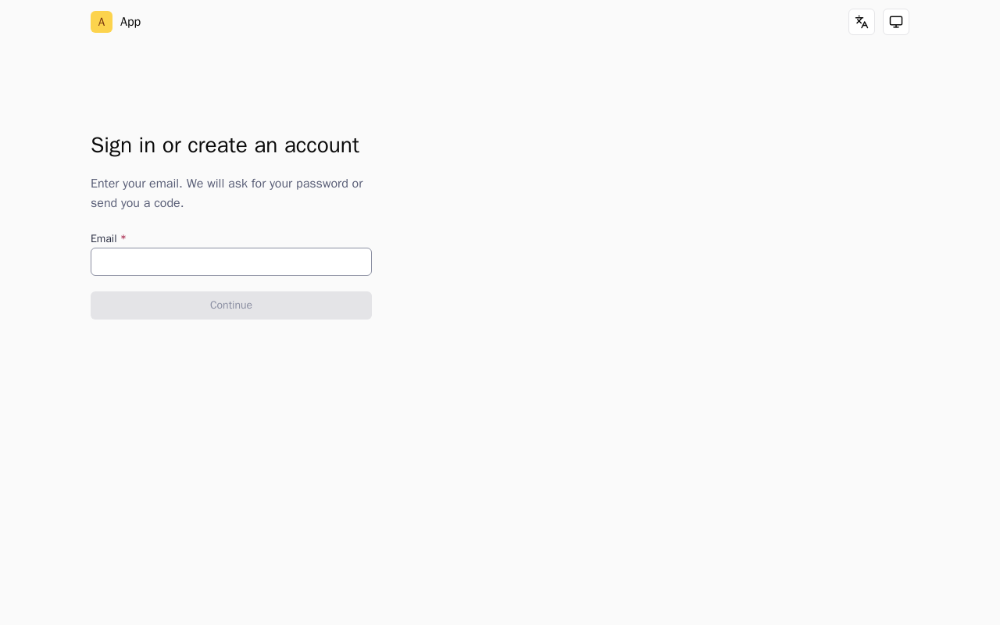
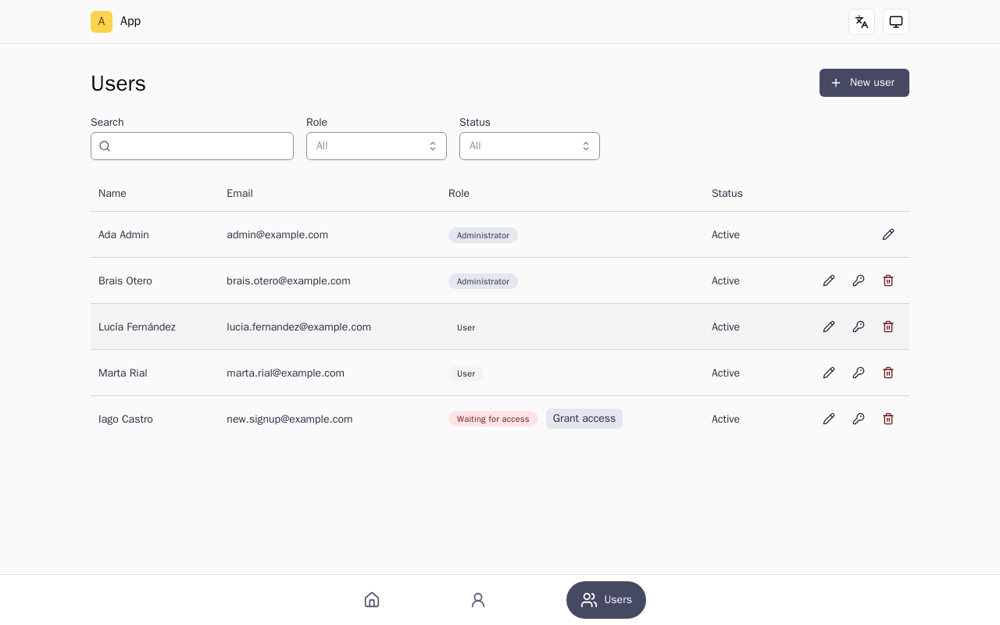
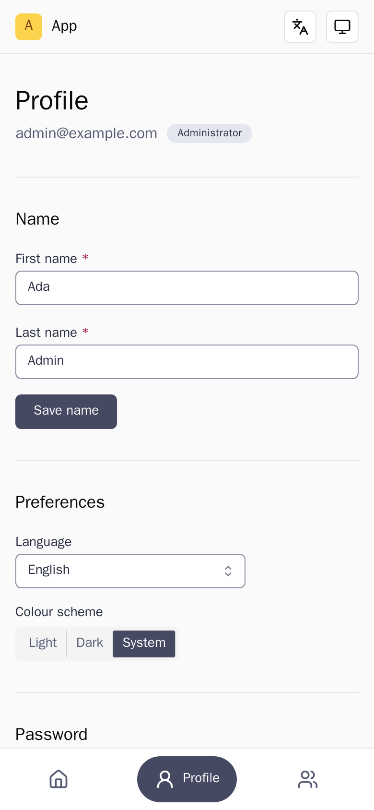
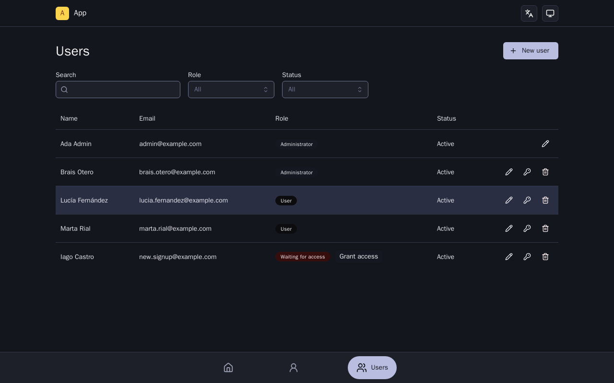

# FastAPI + React template

A starting point for small self-hosted web apps: a FastAPI + PostgreSQL API and a React SPA with
sign-in already done properly, packaged as one Docker image that runs anywhere Docker Compose does
(a Synology NAS included). It also carries a Claude Code setup (`CLAUDE.md`, `.claude/`) so an
assistant works on it with the project's own conventions.

| Sign in | Users (admin) | Profile on a phone |
|---|---|---|
|  |  |  |

Dark mode follows the system or the user's choice: 

## What you get

**Accounts and sign-in**
- Sign in with a 6-digit code sent by email, or with a password; each account uses one method.
- Optional self sign-up (`ALLOW_SELF_SIGNUP`): new accounts wait until an administrator grants access.
- Roles `none` / `user` / `admin`; an administration page to search, create, edit, deactivate, set
  passwords and delete users, with guards (the last administrator stays, you cannot delete yourself).
- Profile: name, language, colour scheme (saved on the account), set or change the password.
- Sessions: short-lived access token in memory, rotating refresh token in an HttpOnly cookie, reuse
  detection, password lockout, rate limits, disposable-email blocking, first admin from the environment.

**Interface**
- React 19 + Mantine 9, English / Spanish / Galician, light and dark themes checked for WCAG AA
  contrast, bottom navigation on every screen size, keyboard and screen-reader friendly.

**Production**
- One non-root, read-only image serving the API and the SPA, with security headers (CSP without inline
  scripts), a secret-key guard, migrations on start and a health check.
- `docker-compose.yml` with PostgreSQL 17 for Synology Container Manager or any Docker host.

**Quality**
- Backend tests against a real PostgreSQL and frontend tests (both ≈100 % coverage), a Playwright
  end-to-end suite against the production image, all in Docker.
- GitHub Actions: lint, tests, end-to-end, image build; Docker Hub publishing when you add credentials;
  weekly rebuilds and Dependabot.

## Start a project from this template

1. **Create the repository**: *Use this template → Create a new repository* on GitHub, then clone it.
2. **Rename**: in `.env.example` set `PROJECT_NAME`, `APP_NAME` (used in emails) and `DOCKER_IMAGE`;
   set `app.name` in `frontend/src/i18n/{en,es,gl}.json` (the brand mark shows it and its initial) and
   the `<title>` in `frontend/index.html`; adapt the first lines of `CLAUDE.md` and `MEMORY.md`; reset
   `CHANGELOG.md`.
3. **Run it**: `make init` (creates `.env` and starts the dev stack), open http://localhost:15173 and
   sign in with `ADMIN_EMAIL` / `ADMIN_PASSWORD` from `.env`. Emails land in Mailpit at
   http://localhost:18025.
4. **Publishing images (optional)**: in the GitHub repository settings add the secrets
   `DOCKERHUB_USERNAME` and `DOCKERHUB_TOKEN` and the variable `DOCKER_IMAGE` (e.g. `yourname/myapp`).
   Pushes to `main` publish `latest`; a published release `v1.2.0` publishes `1.2.0` and `stable`.
   Without them CI only builds the image.
5. **Build your feature**: add a package under `backend/app/` and pages under `frontend/src/pages/`,
   following the skills in `.claude/skills/` (they describe this codebase, not a generic one).

Requirements on your machine: Docker with Compose, `make`, `git`. Nothing else runs on the host.

## Development

| Command | Does |
|---|---|
| `make dev-up` / `make dev-down` | start / stop the dev stack (frontend :15173, backend :18000, Postgres :15432, Mailpit :18025) |
| `make test` / `make lint` / `make qa` | unit tests / linters / both |
| `make e2e` | end-to-end suite against the production image (report in `e2e/artifacts/report`) |
| `make db-revision m="…"` / `make db-migrate` | create / apply a migration |
| `make lock` | re-pin backend dependencies with hashes |
| `make hooks` | pre-commit lint of staged files |
| `make build` / `make up` | build the production image (`$DOCKER_IMAGE:local`) / run `docker-compose.yml` with `APP_TAG` from `.env` (`APP_TAG=local make up` runs your build) |

`make help` lists every target; [`.claude/skills/dev-workflow/SKILL.md`](.claude/skills/dev-workflow/SKILL.md)
explains them.

## Deployment

Copy `docker-compose.yml` and `.env` (from `.env.example`) to the server, set at least `DOCKER_IMAGE`,
`POSTGRES_PASSWORD`, `SECRET_KEY` (64 random hex characters, e.g. `openssl rand -hex 32`), `SITE_URL`, the SMTP settings,
`ADMIN_EMAIL` and `ADMIN_PASSWORD`, then `docker compose up -d`. Put it behind an HTTPS reverse proxy
(on Synology: Login Portal → Reverse Proxy) and set `TRUSTED_PROXIES`.

Every variable, HTTPS and backups: [docs/configuration.md](docs/configuration.md).

## Working with Claude Code

`CLAUDE.md` sets the ground rules and `.claude/` holds the workflow:

```
/dev-1-plan → /dev-2-tasks → /dev-3-run → /dev-4-qa → /push      a feature, planned and QA'd per task
/fix → /push                                                      a small fix
/audit <area>                                                     a consistency review
```

Only want the Claude setup for an existing project? Copy `CLAUDE.md`, `MEMORY.md` and `.claude/`,
keep the generic skills (`git-conventions`, `test-discipline`, `memory-conventions`, `frontend-design`,
`modern-web-guidance`, `security-audit`) and rewrite the stack skills (`architecture`, `api-design`,
`backend-patterns`, `frontend-patterns`, `security`, `ci`, `dev-workflow`) for that codebase.

Plans live in `docs/plans/`, tasks and their QA verdicts in `docs/tasks/`. The skills
(`architecture`, `api-design`, `backend-patterns`, `frontend-patterns`, `security`, `dev-workflow`,
`test-discipline`, `ci`, `git-conventions`, `memory-conventions`, plus `frontend-design`, `modern-web-guidance` and
`security-audit`) describe this stack; QA runs as a separate agent (`.claude/agents/qa.md`).

The principles behind it:

- **Control over raw capability.** An assistant without structure is fast but undirected; the guidelines
  make it plan before coding, ask before assuming and test what it ships.
- **Evidence, not opinion.** QA re-runs every check and saves the output; "the code looks right" is not
  a pass.
- **Total ownership.** A broken test or lint error met along the way gets fixed, whoever caused it.
- **Right-sized architecture.** The minimum structure that keeps the code clear; layers only when a
  real need appears.
- **Docker-first.** Every tool, test and linter runs in a container; the host only needs Docker, git,
  make, and `gh` / `curl` for convenience (CLAUDE.md §9).

The skills system is inspired by [Andrej Karpathy](https://github.com/karpathy)'s approach to
structuring an assistant's context, through [multica-ai/andrej-karpathy-skills](https://github.com/multica-ai/andrej-karpathy-skills).

## Layout

```
backend/      FastAPI app (app/), Alembic migrations, tests
frontend/     React SPA (src/), Vitest tests
e2e/          Playwright suite and its compose stack
dev/          development compose and Dockerfiles
docs/         configuration, plans, tasks, screenshots
Dockerfile, docker-compose.yml   production image and stack
```

## License

[MIT](LICENSE). Changes are listed in [CHANGELOG.md](CHANGELOG.md).
